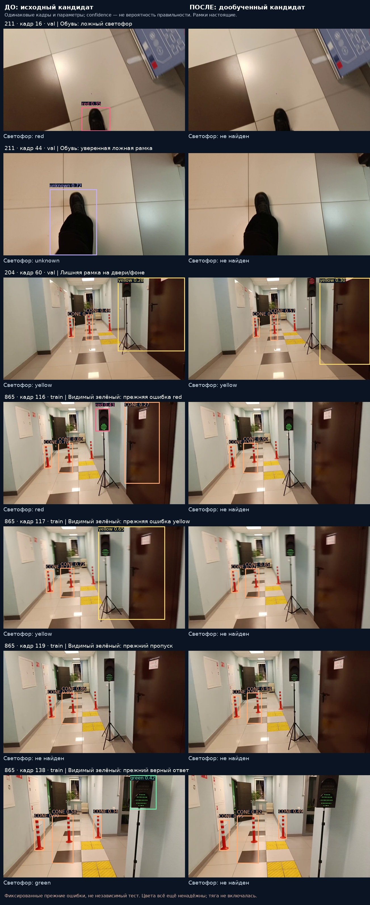
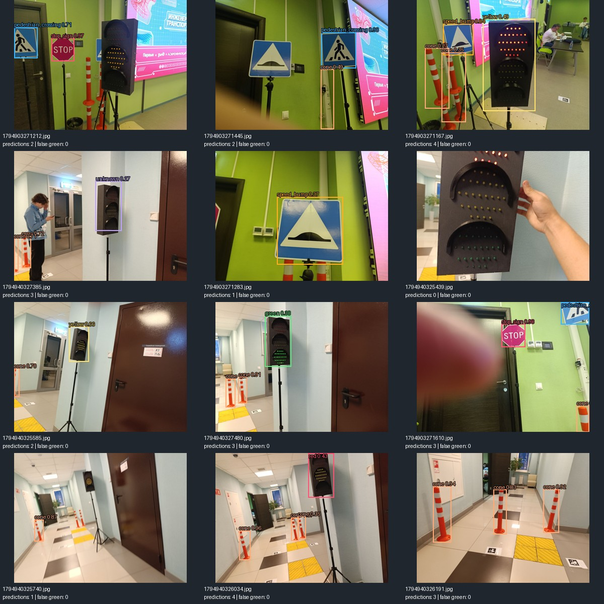

# Дообучение распознавания: результат и регрессии

**17 ноября 2026. Подготовлен отдельный стендовой кандидат. Безусловного
улучшения всех объектов и цветов нет; рабочие веса робота не заменены.**

На прежних 52 test-кадрах доля верных срабатываний выросла **63.5% → 67.4%**,
но полнота нахождения снизилась **62.2% → 61.2%**. Зелёный подтверждён в
**2/3** размеченных случаев вместо **0/3**. Это маленькая шумная выборка,
**не оценка безопасности и не «67% правильных кадров»**.

В полном 98-кадровом val-ролике с обувью число кадров с ложным светофором
снизилось **21 → 11**, однако оставшиеся ошибки чаще стали конкретным
ложным red/yellow, а не unknown. **Обувь и дверь полностью не исправлены.**

## Что изменено

1. Визуально проверены все 260 train / 61 val кадр и 139 исходных рамок
   светофора. Обнаружены смещённые рамки, фон вместо конусов, пропущенные
   объекты и противоречивые цвета. Канонические изображения, метки и split
   **не изменялись в этом цикле**; все 373 изображения проверены по SHA.
2. Создан отдельный `datasets/yolo-stop-refined-color/`:
   - исключены **48 TRAIN-изображений** с наиболее явными ошибками;
   - отфильтрованы **53 подозрительные TRAIN-рамки cone**; 13 настоящих,
     частичных или сгруппированных столбиков после повторного просмотра
     специально сохранены, несмотря на предложение цветовой эвристики;
   - цвета пересмотрены агентом только для **67 TRAIN-изображений**;
     выключенные/неоднозначные и одновременно яркие секции не учатся как green;
   - добавлены **11 TRAIN-негативных кропов** обуви, людей, дверей и мебели
     и **40 TRAIN-кропов светофоров**, с сохранением исходных групп;
   - итог **263 train / 61 val, без test**. Val-метки совпадают с исходными,
     включая их ошибки. Это агентская фильтрация псевдометок, **не независимая
     человеческая ground truth**.
3. От исходного кандидата дообучена та же восьми-классовая YOLOv8n:
   **10 фактических эпох из 20**, early stopping с patience=8, best=эпоха 2.
   CPU, 512 px, batch=8, freeze=10, AdamW lr=0.0005, seed=17; около 589 с.
   Hue shift и отражения выключены. Test в обучении отключён.
4. Добавлен опциональный `traffic_mode=body`: фильтр вертикального тёмного
   корпуса **после NMS**. Он только удаляет рамки; не меняет цвет/уверенность,
   не добавляет green и не восстанавливает подавленный конфликтом green.
   Требование **YOLO-green И HSV-green** цветовой модели сохранено.
5. `RC_VISION_HEURISTIC=0` позволяет точно воспроизвести YOLO-only профиль:
   без добавочных эвристических рамок и без молчаливого fallback без весов.
   По умолчанию сервис работает как прежде. В режимах `body`/`verified`
   резервный ансамбль также не используется.

Фильтр корпуса — эвристика для вертикальных макетов: высота/ширина 1.6…5.5,
минимум 40% тёмных пикселей. Он может ошибочно отсеять настоящий светофор
с неточной рамкой, наклоном или светлым фоном. Такой пропуск показан ниже.

Два ранних запуска прерваны **по результатам аудита данных**, не опубликованы
и не использованы как начальные веса итогового запуска: 9 эпох пяти-классового
прототипа и 2 эпохи до восстановления настоящих cone-рамок. Их CSV, параметры
и причины сохранены в `training/refinement/interrupted-experiments.json`.
Пяти-классовый прототип не заменяет обученную цветовую голову для green.

## Сравнение на одинаковом test

Оба варианта: **52 изображения / 98 объектов**, confidence=0.25, imgsz=512,
IoU сопоставления ≥0.5, CPU, preferRed=False, **без эвристического ансамбля
и без сглаживания**. До — исходный кандидат в legacy; после — дообученный
кандидат + body. Поэтому сравнивается весь явно описанный тракт, а не только
изменение весов. Абляции только на val — в следующем разделе.

| Метрика | До | После |
| --- | ---: | ---: |
| Верные рамки TP | 61 | 60 |
| Ложные рамки FP по имеющимся меткам | 35 | 29 |
| Пропущенные объекты FN | 37 | 38 |
| Precision: доля верных среди срабатываний | **63.5%** | **67.4%** |
| Recall: доля найденных размеченных объектов | **62.2%** | **61.2%** |
| Micro-F1 | 62.9% | 64.2% |

| Объект | TP / FP / FN до → после | Precision до → после | Recall до → после |
| --- | --- | --- | --- |
| STOP | 8/1/1 → 8/1/1 | 88.9% → 88.9% | 88.9% → 88.9% |
| Знак пешеходного перехода | 3/2/0 → 3/2/0 | 60.0% → 60.0% | 100% → 100% |
| **Знак** неровности | 6/4/1 → 5/3/2 | 60.0% → 62.5% | **85.7% → 71.4%** |
| Корпус светофора, любой цвет | 8/6/11 → 9/5/10 | 57.1% → 64.3% | 42.1% → 47.4% |
| Конус / столбик | 36/22/24 → 35/18/25 | 62.1% → 66.0% | **60.0% → 58.3%** |

**Регрессии не скрыты:** потерян ещё один знак неровности и один конус;
фильтр корпуса удалил один верный test-светофор относительно новых весов
без фильтра. Общая полнота стала немного ниже.

### Цвет сигнала — включая пропуски и unknown

| Цвет | Верно / все размеченные до | После |
| --- | ---: | ---: |
| Красный | 1/7 | **1/7** |
| Жёлтый | 1/4 | **1/4** |
| Зелёный | 0/3 | **2/3** |

Отсутствие рамки и unknown **не** засчитываются как правильный цвет.
Наблюдаемых false-green относительно этих меток: 0 в обоих случаях. При
трёх зелёных и шумных координатах это не доказывает нулевой риск. Красный
и жёлтый по-прежнему очень ненадёжны.

## Обувь: просмотрены все кадры, а не только удачные

Весь `VID_20261117_223120_211.mp4`, кадры **0…97**, просмотрен агентом до
нового прогона. Видны обувь, пол, двери, края рекламного плаката и ножка
штатива; видимого корпуса светофора нет. Проверялся только негатив для
`traffic_light`, другие классы не получили независимую полную разметку.
Источник относится к **val** и в новые обучающие данные не добавлялся.

| Вариант | Кадров с ложным светофором / 98 | Ложных рамок | Из них конкретный red/yellow |
| --- | ---: | ---: | ---: |
| Исходный кандидат, legacy | 21 | 22 | 1 |
| Новые веса, без фильтра | **38** | **43** | **32** |
| Новые веса + body | **11** | **11** | **11** |

Первое дообучение само по себе **ухудшило обувь** — это причина добавить и
проверить post-NMS фильтр, а не объявить успешным один выбранный кадр.
После фильтра ложных рамок меньше, но **ложные цветные ответы выросли с
1 до 11** (9 red, 2 yellow). Это важное оставшееся ухудшение, несмотря на
нулевой false-green. Считать задачу ложных сигналов решённой нельзя.

Все 98 кадров — сильно коррелированные наблюдения **одного** короткого
ролика, не 98 независимых сцен и не оценка specificity на новых камерах.
Основание просмотра — `vision-improvement/negative-video-review.json`;
в `negative-video-evaluation.json` сохранены предсказания обоих вариантов
для каждого кадра. Неудачный вариант без фильтра тоже сохранён отдельно.

## Выбор по val и честность повторной проверки

На канонических 61 val-изображении проверены оба checkpoint и три режима
при **одинаковом** пороге. Цель: 0.7 × macro-F1 объектов + 0.3 × balanced
recall цветов с пропусками. Дополнительно false-green=0 на val и не больше
кадров с ложным светофором в val-ролике с обувью, чем у исходного legacy (21).
Это измеримые ограничения выбора, а не доказательство безопасности.

| Веса / режим | Val macro-F1 | Val balanced recall цветов | Ложных кадров обуви / 98 | Итог |
| --- | ---: | ---: | ---: | --- |
| Исходные / legacy | 0.7644 | 0.3495 | 21 | baseline |
| Исходные / body | 0.7778 | 0.3495 | **0** | меньше всего ошибок обуви в этом клипе |
| Исходные / verified | 0.7778 | 0.1414 | 0 | слишком много потерь цвета |
| Новые / legacy | 0.7805 | 0.4768 | 38 | не проходит ограничение обуви |
| **Новые / body** | **0.7779** | **0.4465** | **11** | выбранный стендовой компромисс |
| Новые / verified | 0.7779 | 0.1414 | 11 | слишком много потерь цвета |

У всех шести вариантов false-green=0 на этой val. Более строгая проверка
положения секции `verified` не выбрана: она почти убрала правильные цвета,
в том числе все green на val. Одного уменьшения FP недостаточно.

**Test уже был известен из предыдущей работы.** В этом цикле сначала
проверены новые веса без фильтра; затем весь дополнительный негативный
**val**-ролик обнаружил регрессию обуви. Body-only фильтр использует уже
существовавшие пороги формы корпуса, выбран и зафиксирован на val, после
чего прежний test пересчитан. Следовательно, это **повторно используемый
benchmark, а не новый слепой holdout**. По его результатам фильтр/веса больше
не подбирались. Все промежуточные результаты и SHA профилей сохранены.

Исходный baseline воспроизвёл сохранённые TP/FP/FN и матрицу цветов в точности.
Канонический fingerprint остался
`19c0d37ae4945e955a5e3126a394e2180117847695d6ffe9d3ae7acd043fd276`.
Fingerprint отдельного обучающего варианта:
`dd280f724628cb3aef8553aa3798bcee98138b9340d555a6091b957971d322d3`.

## Прежние сложные эпизоды — в том числе регрессии



Выбраны **до нового inference** из прежнего журнала ошибок, не по успехам
новой модели. Ролики 204/211 относятся к val, 865 — к train, поэтому это
иллюстрации, не независимая оценка. JSON: `vision-improvement/regressions.json`.

- 211/16 и 211/44: ложные рамки на обуви исчезли **в этих двух кадрах**, но
  весь клип всё ещё содержит 11 ошибочных кадров.
- 204/60: ложный yellow на двери/фоне **остался**.
- 865/116 и 865/117: ложные red/yellow исчезли, но настоящий green
  **не найден** — это пропуски, не правильное распознавание.
- 865/119: пропуск остался.
- 865/138: прежний правильный green после body-фильтра потерян —
  **явная регрессия** на настоящем светофоре с неточной рамкой.

Дополнительно сохранена равномерная/поклассовая test-выборка, без отбора
только удачных картинок:



## Файлы и воспроизведение

- `models/vision/yolo-stop-improved.pt` — отдельный checkpoint, SHA-256
  `80543f71999a0a214d5f5eac4dddf9c31efdcdac8f711ec07f9d9c6f1d4f30e6`.
- `yolo-stop-improved.json` — обучение и ограничения; `yolo-stop-improved-profile.json`
  — зафиксированный профиль; `yolo-stop-improved-evaluation.json` — все 52 test-кадра.
- `models/vision/training/refinement/` — CSV, фактические args, recipe/review,
  шесть val-режимов, причины выбора, обе test-проверки и исходная регрессия
  без body-фильтра. Снимок recipe сохранён с исходным SHA; текущий builder
  также сбрасывает label-cache, даже если изменение ID не изменило размер файла.
- Исходные `yolo-stop-candidate.pt/json`, его оценка и рабочие
  `yolo-stop.pt` / `metadata.json` **не перезаписаны**. `.env` робота не менялся.

Сначала восстановить канонические изображения и исходные MP4 из
[закреплённого p25543770-lang/yolo-stop](VISION_SOURCE.md), сохраняя поставленные
метки/split (не перестраивать их ради новых чисел):

```bash
.venv/bin/python scripts/restore_vision_source.py --restore-missing
.venv/bin/python scripts/refine_vision_dataset.py --keep-color-classes \
  --output datasets/yolo-stop-refined-color \
  --review datasets/yolo-stop-refined-color/review.json

OMP_NUM_THREADS=2 MKL_NUM_THREADS=2 .venv/bin/python scripts/train_vision.py \
  --data datasets/yolo-stop-refined-color/data.yaml \
  --weights models/vision/yolo-stop-candidate.pt \
  --output models/vision/yolo-stop-improved.pt \
  --epochs 20 --imgsz 512 --batch 8 --device cpu --workers 0 \
  --freeze 10 --lr0 .0005 --warmup-bias-lr 0 --patience 8 --cache false \
  --validation-only

# Повторная оценка уже зафиксированного профиля; не подбор на test:
.venv/bin/python scripts/evaluate_vision.py \
  --weights models/vision/yolo-stop-improved.pt --split test \
  --confidence .25 --imgsz 512 --no-prefer-red --traffic-mode body \
  --output .cache/vision/repeated-test.json

.venv/bin/python scripts/compare_vision.py \
  --before models/vision/training/refinement/test-baseline-legacy.json \
  --after .cache/vision/repeated-test.json --output .cache/vision/comparison.json
```

**Только стенд, без тяги / с вывешенными колёсами и аппаратным E-STOP:**

```dotenv
RC_VISION_MODEL=models/vision/yolo-stop-improved.pt
RC_VISION_IMGSZ=512
RC_VISION_CONF=0.25
RC_VISION_DEVICE=cpu
RC_VISION_PREFER_RED=0
RC_VISION_TRAFFIC_MODE=body
RC_VISION_HEURISTIC=0
```

После ручного включения `/api/vision/state` должен показать `backend=yolo+body`,
`trafficMode=body`, `heuristicEnabled=false`. Без корректных весов будет
`unavailable`, а не другой резервный алгоритм. Интеграционный smoke на
реальном JPEG совпал с сохранённым предсказанием; камеры и привод не запускались.
Модуль не выдаёт команды моторам и не обходит E-STOP. Измерений FPS на борту нет.

## Проверки и следующий необходимый шаг

Профильные тесты, Node-панель, `compileall`, `git diff --check` и проверка
неизменности рабочих весов выполнены; точные результаты последнего запуска —
`models/vision/training/refinement/checks.json`. В общем pytest сохраняется
известное падение Kinect `test_depth_to_scan_wall_in_front_and_floor_filtered`,
ранее воспроизведённое на базовом commit. Последний полный прогон: **2100 passed,
30 skipped, 2 failed**. Второе падение —
`test_update_reinstalls_and_builds_even_without_requirements_change`: общий
прогон не успел увидеть callback restart, а изолированный повтор прошёл.
Updater и его тест, как и Kinect, совпадают с базовым commit; посторонними
правками эти сбои не скрывались. **Профильный прогон: 121 passed, 1 skipped**.

Для следующего существенного улучшения нужны **полные человеческие рамки и
цвета**, особенно валидные/выключенные табло и негативы обуви/дверей, и новый
отдельный ролик с камеры робота, отделённый по съёмочной сессии. Текущие
псевдометки всё ещё содержат ошибки, а три зелёных test-примера слишком малы
для вывода о надёжности. До этого кандидат остаётся стендовым, не допуском к езде.
