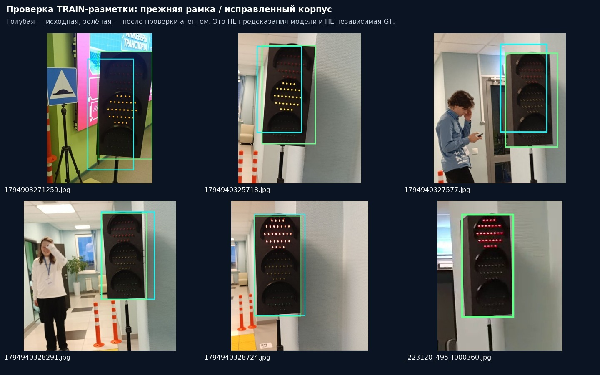
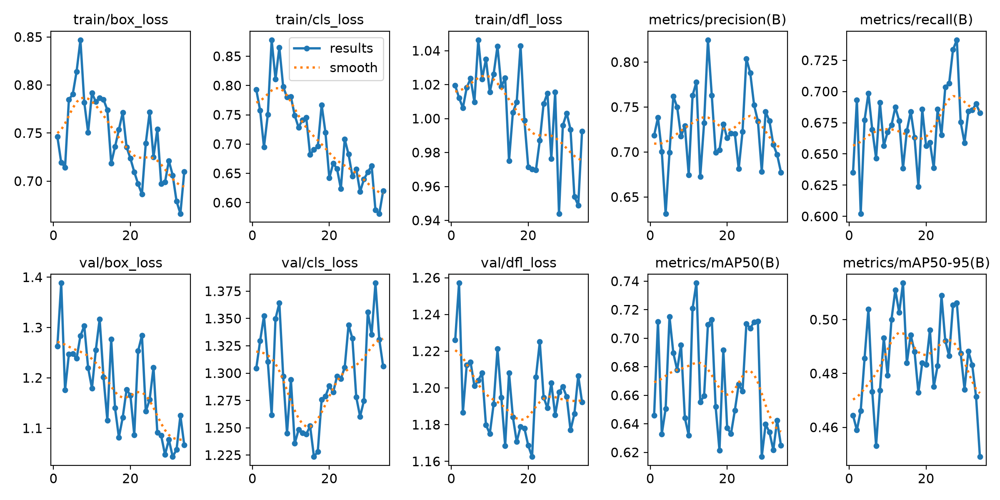
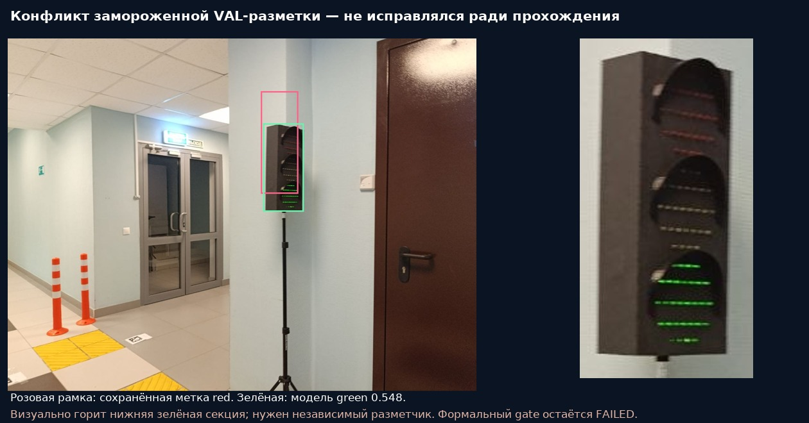
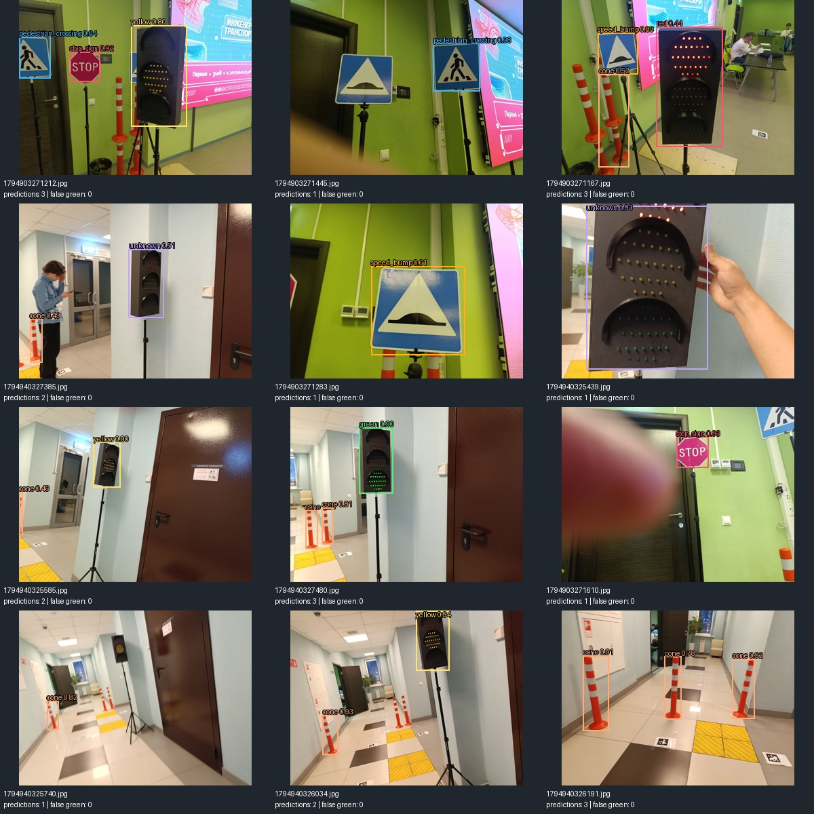
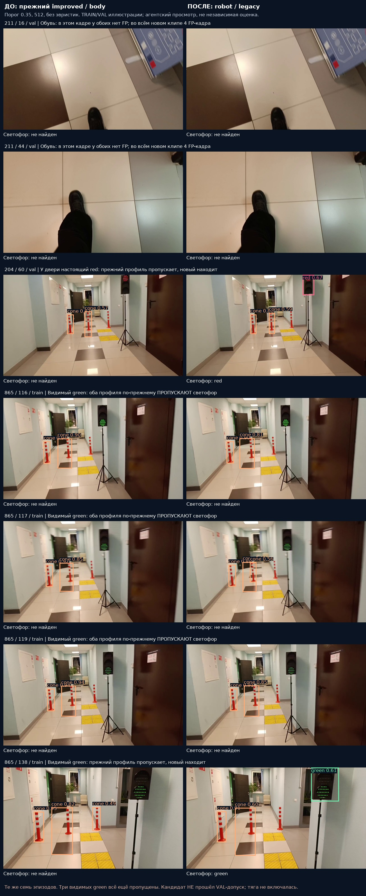

# Дополнительное обучение модели для робота

**Обучение и проверки завершены. Новый кандидат НЕ допущен к применению
на движущемся роботе:** формальные VAL-критерии не пройдены. Отдельные PT и
ONNX сохранены для офлайновых/изолированных стендовых экспериментов. Рабочие
веса не заменены, тяга и E-STOP не менялись.

Фактически выполнены **34 эпохи** финального прогона, выбран **best эпохи 14**
после 20 эпох без улучшения. Лимит 150 — **не** число выполненных эпох и не
доказательство глобального максимума качества. На имеющихся данных цикл
дообучения завершён; надёжность реального робота этим не подтверждена.

## Что входит в этот цикл

Сохранён прежний объём распознавания: STOP, **знаки** пешеходного перехода и
искусственной неровности, отдельные конусы/оградительные столбики, корпус
светофора и red/yellow/green/unknown. Люди, рельеф пола и схема ограждений
не стали новыми классами. Привод, E-STOP, настройки рабочего `.env` и
`models/vision/yolo-stop.pt` не заменяются этим экспериментом.

Предыдущий результат — [VISION_IMPROVEMENT.md](VISION_IMPROVEMENT.md) —
сохранён как исторический контроль. Выполнен отдельный цикл подготовки и
**реального** дообучения, а не только изменение лимита эпох.

## Данные и исправления

Отдельный вариант `datasets/yolo-stop-robot`: **297 TRAIN изображений / 394
рамки**, **61 VAL изображение**. TEST в обучающем варианте отсутствует.

- Визуально проверены 67 исходных TRAIN рамок корпуса светофора: 29 новых
  ручных агентских рамок, 31 просмотренное предложение компоненты, 7 исходных
  рамок сохранены. Реально изменились 60 исходных рамок.
- Убраны грубые захваты стены/стойки/человека и обрезание настоящего корпуса.
  40 производных traffic-кропов пересобраны из исправленных родителей;
  преобразованы все пересекающиеся объекты, в том числе частичные столбики.
  Изменились 39 файлов меток этих кропов.
- Добавлены **34 просмотренных фоновых кропа только TRAIN-видео** с обувью,
  людьми, дверями, стенами и полом. Сомнительные кадры с частями столбиков и
  знаков отклонены, а не помечены пустым фоном.
- Сохранены исходные семейства/группы. Все 61 VAL JPEG и метки побайтно
  совпадают с каноническими. Канонические TRAIN/VAL/TEST не переписываются.
- Исправления **сделаны агентом**, не независимым разметчиком. Остальная
  псевдоразметка всё ещё может быть неточной; «проверено» не означает
  «исчерпывающая человеческая ground truth».



Полные решения: `datasets/yolo-stop-robot/review.json`, изменения:
`changes.json`, происхождение и группы: `samples.json`. Все 67 проверенных
корпусов и исходные предложения негативов сохранены на контактных листах
`models/vision/training/robot/review-*.jpg`. Не все показанные предложения
приняты: окончательный белый список — только `review.json`.

При увеличенном повторном просмотре TRAIN495/360 обнаружилась новая рамка,
захватывающая правую стену. Для неё возвращена более точная исходная рамка.
Подготовительный запуск прерван после **9 завершённых эпох**, его VAL-best
на эпохе **5** сохранён только как warm start с новой инициализацией
оптимизатора; это **не resume на изменившемся датасете** и не финальный
результат. CSV, args, прежний review/fingerprint и причина прерывания
сохранены в `models/vision/training/robot/housing-audit-*`.

## Обучение и выбор

Финальный запуск: YOLOv8n, все обучаемые слои разморожены (`freeze=0`),
CPU, 512, batch 8, AdamW, LR 0.00015, seed 17. Лимит **150 эпох**, ранняя
остановка после **20 эпох без улучшения VAL mAP50–95**. `best.pt` выбирается
по VAL, не `last.pt` и не по TEST. Фактически: **34 завершённые эпохи / best 14**,
**3010.9 с** вместе с финальной raw-валидацией (~50.2 мин), не 150 эпох.

У сохранённого PT отдельная raw-валидация восьми классов: **mAP50 0.658005,
mAP50–95 0.509983**. Внутри обучения CSV-максимум на эпохе 14 — 0.51358
mAP50–95; это другой валидационный проход. Выбор эпохи сделан по CSV,
а для опубликованного файла приведена его последующая проверка. Эти raw AP
не равны F1 полного детектора с HSV и не являются процентом безопасности.



Точный rebuild проверен на **716 файлах изображений и меток**, все 61 VAL
изображение/метка побайтно совпадают с каноническими. Отпечатки:

- новый TRAIN/VAL: `0346f1b0d8f18fcb2d0dabf0baeac799947cd16c4971a1b10635961f622803bf`;
- родительский refined-color: `dd280f724628cb3aef8553aa3798bcee98138b9340d555a6091b957971d322d3`;
- канонический: `19c0d37ae4945e955a5e3126a394e2180117847695d6ffe9d3ae7acd043fd276`.

Сохранены цветовые ограничения аугментации: нет hue shift, горизонтального
отражения знаков или вертикального flip. ONNX/INT8 не используются для
переобучения разметки. Production-файл не является `--output`, `--deploy`
не используется; обучающий скрипт не считает TEST (`--validation-only`).

Профиль выбирается **только на VAL** из заранее ограниченной сетки:
confidence 0.15/0.25/0.35/0.45, режимы `legacy`/`body`, размер 512,
`preferRed=false`, без эвристического ансамбля или fallback.

Цель: `0.7 × macro-F1 пяти объектов + 0.3 × balanced recall трёх цветов`
**включая пропущенные светофоры**. Дополнительные ограничения:

1. наблюдаемый false-green=0 на VAL;
2. не более 21 кадра с ложным светофором в прежнем 98-кадровом VAL-клипе обуви;
3. не более **1 ложного конкретного цвета** red/yellow/green в этом клипе.

Последний пункт не позволяет скрыть прежнюю регрессию, когда рамок стало
меньше, но выдуманных red/yellow — больше. Если ни один новый профиль не
проходит условия, это явно блокирует рекомендацию нового кандидата, а не
молча ослабляет критерии. Старые baseline/legacy, baseline/body и
improved/body считаются контролями. Нулевой наблюдаемый false-green на
маленькой выборке **не** доказывает безопасность.

## Результат VAL: допуска нет

**Ни один из восьми новых профилей не прошёл все условия.** В каждом
зафиксирован один `red->green` относительно замороженных VAL-меток.
`body` обнуляет ложные светофоры в клипе обуви, но не устраняет этот
формальный конфликт. У `legacy` остаются ещё и ложные конкретные цвета.

| Профиль / conf | Macro-F1 | Balanced recall цветов с пропусками | False-green VAL | Кадры обуви с FP / конкретные цвета | Gate |
| --- | ---: | ---: | ---: | ---: | --- |
| baseline / legacy / 0.25 | 0.7644 | 0.3495 | 0 | 21 / 1 | PASS |
| baseline / body / 0.25 | 0.7778 | 0.3495 | 0 | 0 / 0 | PASS |
| previous / body / 0.25 | 0.7779 | 0.4465 | 0 | 11 / 11 | FAIL |
| robot / legacy / 0.15 | 0.7760 | 0.4404 | 1 | 15 / 15 | FAIL |
| robot / body / 0.15 | 0.7862 | 0.4101 | 1 | 0 / 0 | FAIL |
| robot / legacy / 0.25 | 0.8234 | 0.4404 | 1 | 7 / 6 | FAIL |
| robot / body / 0.25 | 0.8279 | 0.4101 | 1 | 0 / 0 | FAIL |
| robot / legacy / 0.35 | 0.8310 | 0.5071 | 1 | 4 / 4 | FAIL |
| robot / body / 0.35 | 0.8294 | 0.4768 | 1 | 0 / 0 | FAIL |
| robot / legacy / 0.45 | 0.8267 | 0.5071 | 1 | 2 / 2 | FAIL |
| robot / body / 0.45 | 0.8251 | 0.4768 | 1 | 0 / 0 | FAIL |

По заранее заданному fallback сохранён **только офлайновый** профиль
`robot / legacy / 0.35` с максимальным VAL objective среди новых вариантов.
Это **не** прошедший допуск победитель: в профиле явно записаны
`candidatePassesRegressionGates=false` и `candidatePreferredToControls=false`.
Лучший прошедший формальные условия контроль — **baseline/body/0.25**,
но это также не сертификация и не автоматическая замена production.

### Почему один формальный false-green нельзя молча «исправить»

Кадр `1794940327787.jpg`: сохранённая метка — **red**, предсказание —
**green 0.548**, в HSV ROI 21 green-пиксель. После фиксации профиля визуально
видно свечение **нижней зелёной секции**; старая рамка также смещена вверх.
Это указывает на конфликт/вероятную ошибку прежней псевдоразметки, а не
само по себе доказывает физически ложный зелёный. Но просмотр агентом —
не независимая истина: **VAL-метка, численные оценки, критерии и профиль
не менялись ради прохождения**. До независимого разбора gate остаётся FAIL.



Исходный SHA, неизменённые строки и предсказание — в
`vision-robot/validation-label-conflict.json`. Это также показывает, почему
дальнейшее увеличение эпох на этих же псевдометках не равно надёжной оценке
качества для робота.

## Повторный benchmark и ограничения

TEST уже многократно использован ранее: это **повторно используемый
benchmark, не новый слепой holdout**. Сначала фиксируются веса/профиль по
VAL, затем один и тот же TEST проверяется с новым кандидатом и двумя
контролями при одинаковых confidence/размере/истине. После этого профиль и
веса не подбираются по TEST. Детекция, правильные цвета с пропусками,
ложные цвета и ухудшения показываются отдельно.

### Один и тот же TEST, порог **0.35** для всех трёх

**52 изображения / 98 размеченных объектов**, IoU≥0.5, 512, CPU,
`preferRed=false`, без эвристического ансамбля и временного сглаживания.
Baseline — legacy, прежний improved — body, новый robot — legacy: сравниваются
полные профили, не только веса. Прежние опубликованные числа при **0.25**
нельзя напрямую смешивать с этой таблицей.

| Метрика | Baseline / legacy | Прежний improved / body | Новый robot / legacy |
| --- | ---: | ---: | ---: |
| TP | 56 | 57 | 58 |
| FP | 27 | 21 | 21 |
| FN | 42 | 41 | 40 |
| Precision | 67.47% | 73.08% | 73.42% |
| Recall | 57.14% | 58.16% | 59.18% |
| Micro-F1 | 61.88% | 64.77% | 65.54% |
| Правильный red / все red | 0/7 | 1/7 | 0/7 |
| Правильный yellow / все yellow | 1/4 | 1/4 | 1/4 |
| Правильный green / все green | 0/3 | 2/3 | 3/3 |
| Наблюдаемый false-green TEST | 0 | 0 | 0 |

Относительно прежнего improved при том же пороге micro-F1 вырос
**64.77% → 65.54%**, распознаны 3/3 вместо 2/3 размеченных green. Но:

- red ухудшился **1/7 → 0/7** по текущим меткам; yellow остался 1/4;
- у светофоров TP 8→10, но и FP **3→5**;
- у STOP FP **1→2**;
- у столбиков TP **33→32**, FN **27→28**, хотя FP уменьшились 14→11;
- нулевой false-green в этом TEST не отменяет провал VAL и не доказывает
  безопасность. Всего три размеченных green слишком мало для общего вывода.

В песочнице CPU новый полный детектор дал median **60.28 мс** / p95
**74.17 мс** на этих изображениях, **без JPEG-декодирования**. Это не
измерение камеры, полного цикла управления или FPS на компьютере робота.

Все рамки/цвета/пропуски: `yolo-stop-robot-evaluation.json`; строгие парные
сравнения — `training/robot/test-comparison-{baseline,previous}.json`.



### Обувь при одинаковом пороге 0.35

| Профиль | FP-кадры / 98 | FP-рамки | Ложные цвета |
| --- | ---: | ---: | --- |
| Baseline / legacy | 13 | 13 | unknown: 12, red: 1 |
| Прежний improved / body | 8 | 8 | yellow: 1, red: 7 |
| Новый robot / legacy | 4 | 4 | red: 4 |

Полный клип улучшился относительно прежнего improved, но **четыре ложных
red остаются**, против одного у исходного baseline. Неиспользованный
`robot/body/0.35` дал 0 shoe FP, однако тоже не прошёл формальный VAL
false-green gate. После TEST режим не переключался ради лучших чисел.
`negative-matched-profiles.json` — постфиксационная проверка, не новый подбор.

### Семь прежних эпизодов, включая оставшиеся пропуски



- 211/16 и 211/44: у обоих профилей в этих двух кадрах нет ложной рамки;
  **весь** новый клип всё ещё содержит четыре FP-кадра.
- 204/60: рядом с дверью **есть настоящий красный светофор**. Новая узкая
  рамка покрывает его, прежний improved/body при 0.35 пропускает. Новое red
  здесь нельзя выдавать за ложный сигнал на двери. Историческая широкая
  ложная yellow-рамка относилась к старому профилю при 0.25.
- 865/116, 117, 119: видимый green по-прежнему **не найден**. Это не успех
  только потому, что ложный цвет не выдаётся.
- 865/138: видимый green восстановлен новым кандидатом.

Это агентские визуальные наблюдения TRAIN/VAL, не независимая количественная
разметка. Предсказания и исходные SHA сохранены в `vision-robot/regressions.json`.

VAL-клип обуви — **одно** короткое видео с 98 сильно коррелированными
кадрами, агентски проверенными только на отсутствие светофоров. Это не 98
независимых сцен и не общая оценка specificity/accuracy. Семь прежних
эпизодов обуви/двери/видимого зелёного — TRAIN/VAL иллюстрации, не независимый
тест. Исчезновение неверного цвета при пропущенном настоящем светофоре
не считается правильным распознаванием.

## Переносимый экспорт

Подготовлен отдельный **FP32 ONNX**, opset 17, с динамическими batch/height/width,
**12 606 676 байт**. `onnx.checker` прошёл. Все **11 raw tensor-проверок**
(8 VAL изображений и 3 синтетических квадратных/альбомных/портретных формы)
и полный `YoloDetector` на **61/61 VAL изображении** прошли:

- классы, сигналы/unknown и число рамок совпадают;
- максимальное абсолютное отклонение raw-тензора: **0.0010376**
  (`allclose`: atol=0.002, rtol=0.0001);
- минимальный IoU парных runtime-рамок: **0.9999665** (требование ≥0.999);
- максимальное отклонение confidence: **0.00000215** (требование ≤0.0001).

Реальный `VisionService` отдельно загрузил PT и ONNX и обработал настоящий
JPEG с совпадением сохранённых предсказаний. Камеры/USB/тяга не открывались.
**Численная переносимость пройдена, допуск качества — нет.** У PT и ONNX
одинаковый экспериментальный/недопущенный статус.

Сырой ONNX выдаёт `[N, 12, anchors]`: первые 4 канала — cx/cy/w/h в пикселях
LetterBox-входа, далее 8 score классов в сохранённом порядке. Отдельного
канала objectness нет. Вход — RGB float32 NCHW /255 после stride-32 LetterBox.
**NMS, HSV-согласование цвета, body-фильтр, свёртка классов и tracker не
вшиты в граф.** Один выход класса green без этих проверок не является
разрешением движения. FP32 выбран без непроверенной INT8-квантизации.

В имеющемся сервисе ONNX может использоваться через тот же `YoloDetector`
и `VisionService`, но Python-обвязка Ultralytics по-прежнему требует своих
зависимостей, включая Torch; экспорт сам по себе не делает весь сервис
Torch-free. Совместимость и FPS на бортовом железе пока не измерялись.

## Опубликованные отдельные файлы

- `models/vision/yolo-stop-robot.pt` — сохранённый best, SHA256
  `ac6c14178f841f0f5f6ed9ff8226614a768741ce10847241948820d0470bd2fe`.
- `models/vision/yolo-stop-robot.onnx` — проверенный переносимый граф, SHA256
  `c7f9c714f68d4bcada23e7e8028664f001f61b8fa5da8a466fd5431e49efdbee`.
- `yolo-stop-robot.json` — параметры обучения, происхождение и явный
  `NOT ACCEPTED for robot deployment`; `yolo-stop-robot-profile.json` —
  неизменный офлайновый профиль, выбранный на VAL до TEST.
- `yolo-stop-robot-evaluation.json` — повторный runtime TEST. Raw-training
  запись `test:null` сохранена отдельно: обучающий скрипт TEST не считал.
- `models/vision/training/robot/` — CSV/args, первоначальный training receipt,
  протокол до обучения, 11 VAL точек/контролей, negative-трассы, зафиксированный
  до TEST профиль, парные сравнения, ONNX parity, service smoke и точный rebuild.

Production `yolo-stop.pt`, исходный baseline и прежний improved сохранили
прежние SHA256; `.env` и настройки привода не менялись.

Офлайновая конфигурация воспроизведения — **не рекомендация для движения**:

```dotenv
RC_VISION_MODEL=models/vision/yolo-stop-robot.pt
RC_VISION_IMGSZ=512
RC_VISION_CONF=0.35
RC_VISION_DEVICE=cpu
RC_VISION_PREFER_RED=0
RC_VISION_TRAFFIC_MODE=legacy
RC_VISION_HEURISTIC=0
```

Для ONNX в изолированном стенде меняется только расширение пути на `.onnx`.
В smoke `backend=yolo`, `trafficMode=legacy`, `heuristicEnabled=false`.
Без корректных весов резерв отключён (`unavailable`), а не подменён другой
эвристикой. **Не копировать эти строки в рабочий `.env` как допуск к езде.**

## Проверки кода и воспроизводимости

- **44 новых теста** на TRAIN-only координаты/фон/семейства, неизменность
  источника/VAL, недопустимые и неутверждённые предложения, ограниченную
  сетку/блокировку допуска, совпадение классов/цветов/рамок при экспорте.
- Профильный набор: **165 passed, 1 skipped**.
- Полный pytest: **2145 passed, 30 skipped, 1 failed**, 342.23 с.
  Единственное падение — прежний Kinect
  `test_depth_to_scan_wall_in_front_and_floor_filtered`; Kinect, его тест
  и sensor-layout побайтно совпадают с базовым commit. Посторонним
  исправлением или скрытием assertions это не маскировалось.
- `compileall`, `git diff --check`, полные SHA/профиль/датасет-проверки,
  численный ONNX parity и реальный service smoke выполнены.

Точные логи и SHA — `models/vision/training/robot/checks.json`; выполненные
логи выбора/экспорта/интеграции вынесены из временного кеша. Повторная проверка
целостности **именно поставленного комплекта**, без инференса и подбора:

```bash
.venv/bin/python models/vision/training/robot/verify-artifacts.py.txt
```

Она сверяет фиксированные SHA весов/ONNX/профиля/VAL-выбора, эпохи в CSV,
три отпечатка датасетов, 61 неизменную VAL-пару и сохранённые результаты
проверок. Результат — `artifact-verification.json`. **Integrity PASS не
превращает quality FAIL в допуск.** После другого обучения с другими
контрольными суммами этот архивный чек намеренно не подтверждает новый комплект.

`render-qualitative.py.txt` восстанавливает контактный лист из тех же семи
исходных кадров и уже сохранённых предсказаний, без нового инференса. В нём
подписи описывают текущий результат, а исторические подписи сохранены отдельно
в `regressions.json`.

## Воспроизведение

Окружение выполненных запусков: `requirements-vision-training.txt`
(Python 3.11, Torch 2.2.2 CPU-исполнение, Ultralytics 8.4.215, NumPy 1.26.4,
OpenCV headless 4.11, ONNX 1.17, ONNX Runtime 1.20.1).

Основа этого обучения — данные
[закреплённого p25543770-lang/yolo-stop](VISION_SOURCE.md). Сначала восстановить
канонические пиксели и все исходные MP4 **без переразметки/переразбиения**:

```bash
.venv/bin/python scripts/restore_vision_source.py --restore-missing
```

Затем собрать родительский refined-color по
[предыдущему рецепту](VISION_IMPROVEMENT.md). MP4 `293/495/760/865` уже будут
в `.cache/vision/video-review/` с проверенными SHA256. Далее:

```bash
# Новый отдельный вариант, не изменять данные во время обучения:
.venv/bin/python scripts/prepare_robot_vision_dataset.py

# Сохранённый промежуточный warm start и его происхождение поставляются отдельно.
OMP_NUM_THREADS=2 MKL_NUM_THREADS=2 .venv/bin/python scripts/train_vision.py \
  --data datasets/yolo-stop-robot/data.yaml \
  --weights models/vision/training/robot/housing-audit-warmstart.pt \
  --output models/vision/yolo-stop-robot.pt --epochs 150 --patience 20 \
  --imgsz 512 --batch 8 --device cpu --workers 0 --freeze 0 \
  --lr0 .00015 --warmup-bias-lr 0 --seed 17 --validation-only --no-download

# VAL-only выбор; нужен также неизменный VAL-видеоклип 211:
.venv/bin/python scripts/select_robot_vision_profile.py

# Проверенный динамический FP32 экспорт, без TEST:
.venv/bin/python scripts/export_robot_vision.py

# Только ПОСЛЕ фиксации профиля: повторный benchmark, service smoke и
# семь прежних эпизодов, без последующего подбора по этим TEST результатам:
.venv/bin/python models/vision/training/robot/final-checks.py.txt
```

Сборка датасета воспроизводится точно по файлам; повторное обучение на
другой архитектуре/версии библиотек не обязано давать битово идентичные веса.
Цепочка исходных COCO-весов и ограничения лицензирования наследуются от
`yolo-stop-candidate.json` и не заменены заявлением об официальной проверке
зеркального checkpoint.

## Что ещё обязательно перед реальным применением

Нужны новые **независимо и полностью размеченные** записи камеры робота,
разделённые по съёмочной сессии: реальные/выключенные табло, все цвета,
повороты, расстояния, смаз, засветка, двери, обувь, люди, частичные знаки и
столбики. Нужны измерения задержки/FPS и обработки потери/устаревания кадра
на целевом компьютере. Затем — стенд без тяги/с вывешенными колёсами и
физическим E-STOP. Модель не получает права снимать E-STOP или самостоятельно
разрешать движение по одному зелёному предсказанию.
