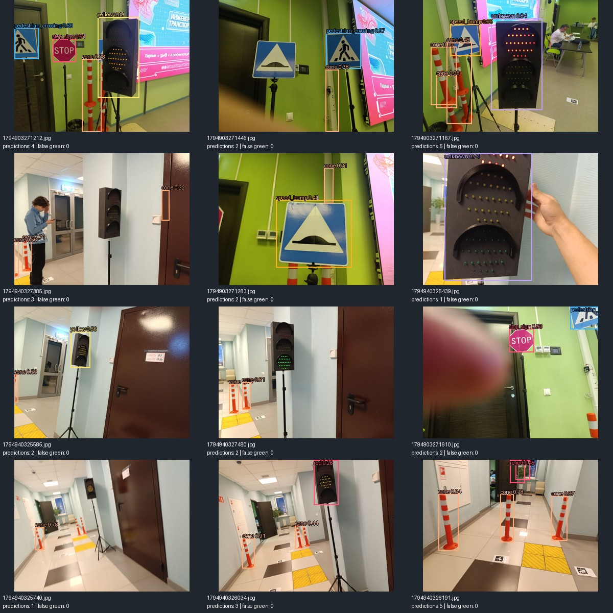

# YOLO для робота — результаты 17 ноября 2026

> Это сохранённый отчёт **исходного кандидата** (baseline). Последующее
> дообучение, сравнение с ним и регрессии: **[VISION_IMPROVEMENT.md](VISION_IMPROVEMENT.md)**.
> Веса и цифры этого baseline не перезаписываются.

## Краткий итог

**Обучен и проверен кандидат YOLOv8n, но задача надёжного распознавания
цветов светофора пока НЕ решена. Для автономной езды эта версия не готова.**

Знаки STOP и неровности распознаются заметно лучше, чем сигналы светофора.
Общий test mAP50 = **0.6131**, mAP50–95 = **0.4606**. Это оценки на смешанной
псевдоразметке, а не подтверждённая точность на камерах робота. Рабочая
`models/vision/yolo-stop.pt` и её метаданные **не заменены**.

### Файлы

- **[yolo-stop-candidate.pt](../models/vision/yolo-stop-candidate.pt)** — выбранные веса, 6 482 723 байта.
- [yolo-stop-candidate.json](../models/vision/yolo-stop-candidate.json) — хэш,
  происхождение, этапы, параметры, val/test по каждому классу и выбор порога.
- [yolo-stop-candidate-evaluation.json](../models/vision/yolo-stop-candidate-evaluation.json)
  — YOLO + проверка цвета: TP/FP/FN и предсказания для всех 52 тестовых кадров.
- [yolo-stop-candidate-ensemble.json](../models/vision/yolo-stop-candidate-ensemble.json)
  — то же для **YOLO + резервная эвристика**, как в стандартном сервисе робота.
- [Протоколы обучения и калибровки](../models/vision/training/README.md) —
  CSV обеих тренировок, фактические `args.yaml`, источник COCO и проверки val.
- Локально экспортирован `models/vision/yolo-stop-candidate.onnx`, FP32,
  12 692 750 байт. ONNX игнорируется Git согласно правилам проекта;
  ниже приведена команда повторного экспорта из сохранённого `.pt`.

SHA-256 конечного `.pt`:

```text
fd6f1514770a364471f2d0cedfe431bcce41c5f3f5969c7eb8eb9aaab9a1f76c
```

## Данные и честность оценки

Источник: [p25543770-lang/yolo-stop](https://github.com/p25543770-lang/yolo-stop),
commit `3cb277bfadf7d0034943117f9146d4b92bb773a9`.

- 415 исходных JPEG, вложенный старый ZIP, 8 видеороликов.
- Удалены 107 точных копий: осталось **308 фото + 65 видеокадров = 373**.
- **733 рамки**; 260 train / 61 val / 52 test.
- Кадры одного видео и близкие pHash объединены в группы перед разбиением.
  SHA-дубликатов и пересечений этих групп между частями нет.
- В 214 изображениях применены визуальные исправления агента / сохранённые
  исторические рамки. Остальные 159 используют bootstrap-предложения.
  Это **не независимо проверенный человеческий ground truth**. Сохраняются
  пропуски мелких объектов, частичные рамки и ложные предложения на фоне.
- Все восемь классов присутствуют во всех трёх частях, но отдельных примеров
  цвета очень мало: в test лишь 7 red, 4 yellow и 3 green.
- Почти всё снято на одном полигоне. Группировка не превращает разные ракурсы
  одного помещения в независимые условия эксплуатации.

Переносимый fingerprint изображений, меток и разбиения:

```text
19c0d37ae4945e955a5e3126a394e2180117847695d6ffe9d3ae7acd043fd276
```

## Как обучали и выбирали

Среда: Python 3.11.2, Torch 2.2.2+cu121, Ultralytics 8.4.215,
NumPy 1.26.4, OpenCV headless 4.11.0; видимы 2 CPU, около 3.8 GiB RAM,
**CUDA недоступна, обучение выполнено на CPU**. Ключевые версии закреплены
в `requirements-vision-training.txt`.

| Этап | Выполнено | Вход / batch | Заморозка / AdamW lr | Лучшая эпоха | val mAP50 | val mAP50–95 |
| --- | ---: | --- | --- | ---: | ---: | ---: |
| COCO → новые 8 классов | 40 / 40 | 416 / 8 | freeze=10 / 0.001 | 38 | 0.6214 | 0.4481 |
| Полное дообучение от первого best | 25 / 25 | 512 / 8 | freeze=0 / 0.0002 | 17 | 0.6092 | **0.4886** |

Всего выполнено **65 эпох**, около **69.4 минуты** вместе с завершающими
проверками этих этапов. Веса каждого этапа — его **best**, не последняя эпоха.
Выбран второй этап по наибольшему **val mAP50–95**, при записанном размере
входа. **Test не использовался для выбора весов или порога**. Оба этапа
использовали неизменный fingerprint датасета. Пробный warm start от старой
рабочей модели был прерван и не является финальным результатом.

Hue shift и отражения отключены, чтобы не менять смысл цветов и знаков.
Остались умеренные яркость/поворот/масштаб/перспектива; seed=17,
mosaic=0.5 с отключением в последних 10 эпохах. В первом этапе фактический
`warmup_bias_lr=0.1`, во втором `0.0`; оба значения сохранены в `args.yaml`.

Исходные COCO-веса получены из закреплённого стороннего зеркала, потому что
официальная release-загрузка была недоступна. SHA содержимого проверяется
`fetch_vision_weights.py`, код зеркала не запускается. Хэш **не сверен
независимо** с официальным релизным файлом; происхождение и лицензионная
оговорка сохранены в [pretraining.json](../models/vision/training/pretraining.json).

## Метрики нейросети по классам

AP50 — площадь под precision/recall при IoU ≥ 0.5, **не процент правильных
кадров**. Это метрики восьми исходных классов YOLO до HSV-fusion.

| Класс | Рамок train / val / test | val AP50 | test AP50 | test AP50–95 |
| --- | ---: | ---: | ---: | ---: |
| STOP | 56 / 7 / 9 | 79.7% | **84.8%** | 67.6% |
| Пешеходный переход | 13 / 2 / 3 | 99.5% | 99.5% | 89.6% |
| **Знак** неровности | 35 / 7 / 7 | 71.3% | **86.3%** | 68.3% |
| Неоднозначный / выключенный светофор | 38 / 8 / 5 | 60.1% | 93.8% | 58.8% |
| Конус / оградительный столбик | 313 / 63 / 60 | 69.4% | **62.5%** | 44.1% |
| Красный светофор | 38 / 11 / 7 | 23.6% | **6.1%** | 2.7% |
| Жёлтый светофор | 18 / 3 / 4 | 36.1% | **24.5%** | 22.1% |
| Зелёный светофор | 18 / 5 / 3 | 47.7% | **33.0%** | 15.4% |

Старые «mAP50 0.77» относились к другой пяти-классовой модели и крошечной
валидации на эвристических метках. Сравнивать их напрямую с этой таблицей
и объявлять улучшение/ухудшение на роботе нельзя.

## Рабочий порог и проверка всей обработки

На **val** проверены confidence 0.15 / 0.25 / 0.35 / 0.45 и два режима
`prefer_red`. Заранее заданная цель: 0.7 × macro-F1 пяти типов объектов +
0.3 × balanced recall трёх цветов, без false-green на val. Выбраны
**512 px, confidence=0.25, prefer_red=False**. Полные восемь конфигураций
сохранены в `training/calibration-*/`; test в этом подборе не участвовал.
Это экспериментальная настройка распознавания, **не допуск к движению**.

После фиксации настроек проверены 52 test-кадра. Для стандартного ансамбля
сервиса, при сопоставлении рамок IoU ≥ 0.5:

| Объект | TP / FP / FN | Precision | Recall |
| --- | ---: | ---: | ---: |
| STOP | 8 / 1 / 1 | 88.9% | 88.9% |
| Знак неровности | 6 / 4 / 1 | 60.0% | 85.7% |
| Конусы / столбики | 42 / 43 / 18 | 49.4% | 70.0% |
| Корпус светофора, любой цвет | 9 / 12 / 10 | 42.9% | 47.4% |

**Цвета после fusion: red правильно 1/7, yellow 1/4, green 0/3.**
False-green = 0, но система не подтвердила ни одного green; это **не успех
проверки безопасности**. Зелёный требует согласия цветовой головы YOLO и
HSV, поэтому при такой слабой нейросетевой классификации получается много
unknown/пропусков. Не следует убирать эту проверку лишь ради красивых цифр.

Предсказания и «ошибки» сравниваются с неполными псевдометками: часть FP может
быть реально существующими, но не размеченными объектами. Это ещё одна
причина сначала исправить метки, а не бесконечно увеличивать число эпох.

После прогрева медиана обработки одного кадра здесь: **62.7 ms** YOLO+fusion,
**75.5 ms** ансамбль; P95 70.3 / 82.3 ms. Измерение исключает JPEG decode.
Это **не FPS четырёх камер и не замер на компьютере робота**.

### Реальные примеры, включая ошибки и пропуски

Выборка по классам и порядку файлов, не по успешности предсказаний. Например,
зелёный светофор и некоторые знаки остались без рамки; фон местами принят
за конус, жёлтый сигнал — за красный. Все предсказания остальных test-кадров
тоже сохранены в JSON, а не скрыты за удачными картинками.



## Интеграция и защита от ошибочного разрешения

Публичные id первых пяти классов API сохранены. Новые цветовые головы
сводятся к `traffic_light` + `signal`. Модуль не управляет моторами.

- Green требует согласия YOLO и HSV; generic/off/смешанный цвет не дают green.
- Резервная эвристика в ансамбле не может обойти это правило своим green.
- Конфликтующие пересекающиеся цветовые рамки не выбирают green только из-за
  большей confidence. Это консервативная мера, а не гарантия качества.
- Старые голоса, unknown-кадры и повторное использование кадра другой камеры
  не поддерживают green бессрочно. Возраст свидетельства считается от
  **захвата кадра**, а не окончания медленного inference.
- `RC_VISION_PREFER_RED=1` дополнительно усиливает red внутри ROI, между
  камерами и в трекере. Это более ограничительный режим; он не исправляет
  низкое качество цветового детектора. Значение 0 всё равно сохраняет
  проверку согласия и отклонение неоднозначного HSV.

Только для **стендового просмотра с отключённой тягой / вывешенными колёсами**:

```dotenv
RC_VISION_MODEL=models/vision/yolo-stop-candidate.pt
RC_VISION_IMGSZ=512
RC_VISION_DEVICE=cpu
RC_VISION_CONF=0.25
RC_VISION_PREFER_RED=0
```

После перезапуска проверить `/api/vision/state`: ожидается `backend=yolo+heuristic`
и имя нового файла. `heuristic` означает резерв без загруженного кандидата,
а не равноценную замену цветовой нейросети. Не подключать `action=go` к тяге
без независимой проверки и аппаратного E-STOP.

## Воспроизведение

Установка / headless OpenCV: [VISION.md](VISION.md). Источник и проверка
связи с этим обучением: [VISION_SOURCE.md](VISION_SOURCE.md). Восстанавливать
поставленные пиксели нужно без повторного предложения меток и разбиения:

```bash
.venv/bin/python scripts/restore_vision_source.py --restore-missing
.venv/bin/python scripts/fetch_vision_weights.py

OMP_NUM_THREADS=2 MKL_NUM_THREADS=2 .venv/bin/python scripts/train_vision.py \
  --weights .cache/vision/pretrained/coco-repacked.pt --device cpu \
  --epochs 40 --imgsz 416 --batch 8 --freeze 10 --lr0 .001 \
  --warmup-bias-lr .1 --patience 15 --cache disk --validation-only
cp models/vision/yolo-stop-candidate.pt .cache/vision/stage1-coco.pt
cp models/vision/yolo-stop-candidate.json .cache/vision/stage1-coco.json

OMP_NUM_THREADS=2 MKL_NUM_THREADS=2 .venv/bin/python scripts/train_vision.py \
  --weights .cache/vision/stage1-coco.pt --device cpu \
  --epochs 25 --imgsz 512 --batch 8 --freeze 0 --lr0 .0002 \
  --warmup-bias-lr 0 --patience 10 --cache disk --validation-only

# Подбор только на val, отдельно для обоих режимов:
.venv/bin/python scripts/evaluate_vision.py --calibrate --imgsz 512 \
  --output .cache/vision/red-priority/summary.json
.venv/bin/python scripts/evaluate_vision.py --calibrate --imgsz 512 --no-prefer-red \
  --output .cache/vision/ambiguous-unknown/summary.json

# Только после фиксации модели и параметров — test:
.venv/bin/python scripts/evaluate_vision.py --confidence .25 --imgsz 512 \
  --no-prefer-red --preview docs/vision-candidate-preview.jpg
.venv/bin/python scripts/evaluate_vision.py --ensemble --confidence .25 --imgsz 512 \
  --no-prefer-red --output models/vision/yolo-stop-candidate-ensemble.json
```

Дополнительная итоговая `YOLO(...).val(split='test')` сохранена в metadata.
ONNX можно пересоздать:

```bash
.venv/bin/python -c "from ultralytics import YOLO; YOLO('models/vision/yolo-stop-candidate.pt').export(format='onnx', imgsz=512, opset=17, simplify=False, dynamic=False, device='cpu')"
```

Экспорт проверен `onnx.checker` и ONNX Runtime 1.20.1: вход `[1,3,512,512]`,
сырой выход `[1,12,5376]`. Максимальная абсолютная разница с Torch на одном
одинаковом тензоре = **0.000519**, допуск `rtol=1e-3, atol=2e-3` пройден.
Это проверка арифметики экспорта, не качества распознавания. Нужны одинаковый
letterbox/preprocess, NMS, маппинг классов и fusion; raw ONNX сам их не заменяет.
Настоящие `.pt` и `.onnx` также загружены через `YoloDetector`, а `.pt`
проверен через `VisionService` на реальном JPEG без камер/привода.

## Проверки кода

- **74/74** профильных Python-теста: разметка, группировка, дубликаты,
  fingerprint, защита рабочих весов, best/last, fusion, трекер, камеры,
  адаптер новых классов, выбор порога без test.
- Полный pytest: **2037 passed, 29 skipped, 1 failed**. Известное падение
  `test_kinect_depth.py::test_depth_to_scan_wall_in_front_and_floor_filtered`
  воспроизведено и на исходном commit; Kinect и этот тест не менялись.
  После этого добавленный тест калибровки прошёл в профильном запуске.
- `node tests/js/vision_panel.js` — OK. `py_compile` и `git diff --check` — OK.

## Что нужно, чтобы довести до робота

1. **Полная ручная проверка рамок и цветов**, в том числе непомеченных дальних
   знаков/конусов, выключенных табло, нескольких секций и отрицательных кадров.
   Исправления передаются в `vision_dataset.py --annotations ...`.
2. Новые независимые видео **с камер робота**: разные расстояния/ракурсы,
   смаз, экспозиция, LED-мерцание, засветка, фон без знаков, перекрытия конусов.
   Test отделять по съёмочной сессии/дню, не соседними кадрами.
3. После исправления меток сохранять старые split-группы либо начинать новое
   обучение от COCO: новый test не должен содержать изображения, на которых
   уже обучались начальные веса. Перестратификация после правок может менять
   разбиение; отсутствие SHA-дубликатов само по себе историю обучения не учитывает.
4. Измерить FPS и пропуски на бортовом компьютере; нужны его модель,
   ускоритель/ОЗУ и целевой FPS четырёх камер. GPU позволит проверять 640 px
   и более длинные прогоны, но не заменит качественную разметку.
5. Испытания сначала без тяги, затем только в контролируемых условиях с
   оператором и независимым E-STOP. Сейчас цветовая часть этот этап не прошла.

`speed_bump` здесь — **дорожный знак**, не физический рельеф пола. `cone`
обозначает отдельные столбики ограждения; безопасную линию объезда/траекторию
эта модель не строит. Глубина, препятствия и торможение остаются отдельными
подсистемами робота.
