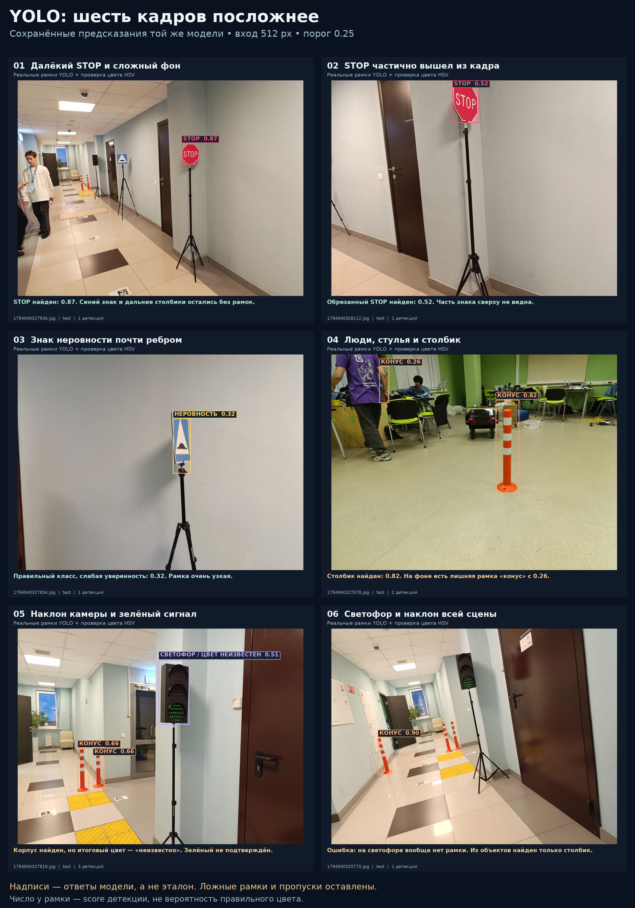

# Более сложные кадры: реальные предсказания YOLO



## Открыть каждое фото крупно

1. [Далёкий STOP и сложный фон](01-distant-stop.jpg) — STOP 0.87; синий знак и дальние столбики без рамок.
2. [STOP частично за границей кадра](02-cropped-stop.jpg) — найден, score 0.52.
3. [Знак неровности почти ребром](03-edge-on-bump.jpg) — найден, score 0.32.
4. [Люди, стулья и столбик](04-clutter-and-false-positive.jpg) — столбик 0.82; есть лишняя рамка «конус» 0.26.
5. [Наклон камеры и зелёный сигнал](05-unknown-green.jpg) — корпус найден, итоговый цвет `unknown`.
6. [Наклон всей сцены, пропуск светофора](06-missed-traffic-light.jpg) — на светофоре нет рамки; найден только столбик.

## Откуда взяты рамки

Это **отрисовка уже сохранённого прогона**, а не новый запуск нейросети и не
синтетические примеры. Исходные фото восстановлены из закреплённого
[p25543770-lang/yolo-stop](https://github.com/p25543770-lang/yolo-stop/tree/3cb277bfadf7d0034943117f9146d4b92bb773a9).
Проверены SHA-256 всех шести JPEG по `datasets/yolo-stop/samples.json`.
Все кадры из test-части, выбранные по дальности, ракурсу, обрезанию и фону;
они не повторяют 12 фотографий предыдущей обзорной иллюстрации.

Рамки, классы, оценки и итоговые сигналы перенесены **без изменений** из
`models/vision/yolo-stop-candidate-evaluation.json`: YOLO + HSV fusion,
confidence=0.25, imgsz=512, prefer_red=False, без добавочной эвристики.
SHA-256 модели проверен по существующему `.pt`:

```text
fd6f1514770a364471f2d0cedfe431bcce41c5f3f5969c7eb8eb9aaab9a1f76c
```

В [predictions.json](predictions.json) сохранены исходные координаты,
источники и хэши. Никаких «пропущенных» рамок вручную не дорисовывалось.
Изменены лишь размер отображения, подписи и оформление; фотографии не
затемнялись, не размывались и не дополнялись объектами.

Число у рамки — score детектора, **не калиброванная вероятность** правильного
ответа или цвета. Тексты под кадрами — визуальные комментарии к ошибкам,
а не ответы нейросети. `unknown` — отказ подтвердить цвет, не зелёный.

### Замечание для следующей проверки разметки

Для `1794940325770.jpg` (фото 6) в сохранённой псевдоразметке стоит
`traffic_light_yellow`, хотя на самом снимке визуально горит зелёная секция.
Цветовую метку нужно проверить вручную. В иллюстрацию этот ошибочный эталон
не переносился. Исходный датасет, веса и метрики в этом показе не менялись.
Это дополнительная причина не принимать псевдометки за независимый ground truth.

Полные результаты и ограничения: [VISION_TRAINING.md](../VISION_TRAINING.md).
Кандидат **не готов для автономной езды**; рабочая модель робота не заменялась.
